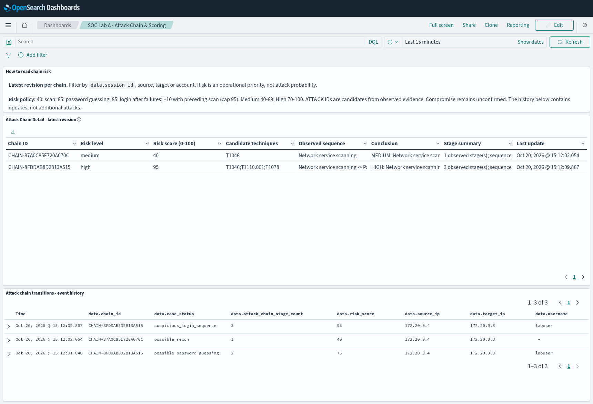

# Lab A 0.4.5: Attack Chain Detail và Scoring trên Wazuh

Bản 0.4.6 có [dashboard điều tra riêng và chuỗi năm bước có probe endpoint](CHAIN-INVESTIGATION-VI.md).
Hướng dẫn 0.4.5 bên dưới vẫn áp dụng cho dashboard ban đầu.

## Phạm vi của bản này

Log cập nhật của người dùng đã đạt 66/66 kiểm tra trên Windows. Bản 0.4.5 bổ
sung bảng tương tự ảnh Lab B, dựa trên correlation đang có của Lab A:

```text
Quét nhiều cổng → nhiều lần sai mật khẩu → đăng nhập thành công sau chuỗi sai
```

Ba bước dùng bằng chứng SYN và auth thật, cùng nguồn/đích/tài khoản và cửa sổ
thời gian. MLP không tự sinh auth stage; HTTP bình thường không tự thành C2.
Không gọi ba bước này là một full kill chain hoặc xác nhận máy bị chiếm quyền.
T1059 (thực thi trình thông dịch), T1105 (tool transfer), T1071 (C2 qua application
protocol) cần thêm bằng chứng riêng. SSH mã hóa không cung cấp nội dung lệnh.



**Ảnh minh họa dùng dữ liệu tổng hợp trong môi trường kiểm thử, không phải kết
quả attack chain của Lab A thật.** Bảng chính hiển thị revision mới nhất 95;
bảng lịch sử giữ cả 75 và 95. Các bước cài/import và test thật ở dưới.

Ảnh Lab B chỉ cho thấy kết quả bảng. Trong source B đã được cung cấp, việc suy
process execution từ rule level, tool transfer từ mọi file change hoặc C2 từ
mọi outbound connection chưa đủ căn cứ cho các kết luận đó. Lab A giữ rõ các
ranh giới bằng chứng khi học cách trình bày và tổng hợp từ B.

## Trường mới và cách tính điểm

Correlation event có thêm:

| Trường trên Wazuh | Ý nghĩa |
|---|---|
| `data.chain_id` | ID hiển thị ổn định của một correlation case |
| `data.risk_level`, `data.risk_score` | Ưu tiên điều tra, không phải xác suất |
| `data.techniques` | ATT&CK ứng viên từ các stage có bằng chứng |
| `data.attack_type` | Chuỗi bước đọc được |
| `data.conclusion` | Kết luận để điều tra; compromise vẫn chưa xác nhận |
| `data.attack_summary` | Số bước đã quan sát và giới hạn kết luận |
| `data.attack_chain_stage_count` | Số stage, khác số bản cập nhật hoặc số alert |
| `data.risk_score_base`, `data.risk_score_recon_bonus` | Thành phần giải thích điểm |

Chính sách `soc-operational-risk/0.1` không đổi:

| Bằng chứng | Điểm | Mức |
|---|---:|---|
| ≥20 cổng TCP đích khác nhau/10 giây, cùng sensor/nguồn/đích | 40 | medium |
| ≥8 auth password failures/60 giây, cùng nguồn/đích/tài khoản | 65 | medium |
| Chuỗi failures có recon trước đó trong cửa sổ 600 giây | 75 | high |
| Success sau chuỗi failures trong cửa sổ 300 giây | 85 | high |
| Success sau failures và có recon trước đó | 95 | high |
| SQLi indicator | 60, hoặc 70 nếu có recon trước | medium/high |

Medium từ 40, High từ 70; case score được chặn tại 95. Công thức case là
`min(95, base + preceding_recon_bonus)`, bonus bằng 10 khi có recon và stage
khác. `risk_score` khác `rule.level` và khác `score_max` MLP. Cảnh báo MLP
false positive của ca HTTP trước vẫn được giữ làm bằng chứng đánh giá model.

Ứng viên ATT&CK: [T1046](https://attack.mitre.org/techniques/T1046/) cho network
service scanning, [T1110.001](https://attack.mitre.org/techniques/T1110/001/) cho
password guessing, [T1078](https://attack.mitre.org/techniques/T1078/) cho login
sau chuỗi failures. `techniques_are_hypotheses=true`. SQLi chưa được gán T1190
khi chưa biết ứng dụng có public-facing hay không. Không thêm technique chỉ
để đủ số bước như ảnh tham khảo.

## Cập nhật source trên Windows

Dùng gói vá `SOC-AI-Lab-A-v0.4.5-Chain-Dashboard-20261020.zip` cho source đã có
0.4.4. Gói cũng chứa các sửa EVE/flow-ID trước đó. Chờ phiên Live hiện tại kết
thúc rồi backup và giải nén trực tiếp vào:

```text
E:\SOC-Lab\AI\SOC-AI-v0.4-research
```

Tên thư mục giữ nguyên để không làm đổi đường dẫn model/venv. Không cần train
lại, cài lại bridge, restart Wazuh hoặc chạy setup_recon.py nếu SID 9900003 đã
cài thành công. XML rule ID 119203/119204/119205 vẫn được dùng. Trường mới được
JSON decoder/indexer tiếp nhận từ các correlation event phát sau cập nhật.

```powershell
$ErrorActionPreference = 'Stop'
Set-Location 'E:\SOC-Lab\AI\SOC-AI-v0.4-research'
$py = 'E:\SOC-Lab\AI\.venv-ai04-cpu\Scripts\python.exe'
& $py -m unittest -v test_chain_dashboard test_wazuh_realtime test_lab_correlation test_lab_recon test_recon_diagnostic test_wazuh_scenarios
if ($LASTEXITCODE -ne 0) { throw 'Kiểm tra source chưa đạt.' }
```

## Import bảng vào Wazuh Dashboard

1. Dùng phiên đăng nhập Wazuh Dashboard hiện tại, chọn tenant đang dùng.
2. Mở **Dashboards Management → Saved objects**. Nếu giao diện nhóm mục khác,
   tìm **Saved objects** trong phần quản lý Dashboards.
3. Bấm **Import**, chọn file:

   ```text
   E:\SOC-Lab\AI\SOC-AI-v0.4-research\dashboards\soc-ai-attack-chain.ndjson
   ```

4. Gói có 5 object, ID đều bắt đầu `soc-ai-`. Khi import lại có thể ghi đè đúng
   5 object này. Không cần xóa index pattern hay dashboard Wazuh hiện có.
5. Mở **Dashboards**, tìm **SOC Lab A - Attack Chain & Scoring**.
6. Chọn khoảng thời gian chứa phiên test; dashboard lưu mặc định Last 15 minutes
   và auto refresh 1 giây. Nếu URL/thiết lập trình duyệt giữ khoảng thời gian cũ,
   chọn lại trên time picker.

Gói dùng index pattern riêng trỏ tới `wazuh-alerts-*`, không thay default index,
mapping, TLS, tài khoản hoặc quyền truy cập. Điểm dùng **Top Hit mới nhất** để
hiển thị được ngay cả khi Wazuh indexer lưu custom number thành keyword string.
Không cần ép mapping hoặc reindex. Nếu tài khoản hiện tại không có quyền import
Saved objects, dùng vai trò quản lý Dashboard hiện có; không gửi mật khẩu vào chat.

Gồm ba panel: hướng dẫn đọc điểm, bảng **Attack Chain Detail - latest revision**,
và **Attack chain transitions - event history**. Bảng chính chỉ có một dòng cho
mỗi `chain_id`, lấy mọi cột ở revision mới nhất; không cộng/trung bình risk các
revision. Lịch sử giữ riêng các cập nhật 75 → 95. Không dùng số dòng/Count làm
số stage hoặc số lần bị tấn công.

Một recon case độc lập có thể xuất hiện trước case theo tài khoản được tạo ở
bước failures. Đây là hai correlation hypothesis, không phải hai cuộc tấn công
đã được chứng minh. Case theo tài khoản giữ cùng chain_id khi từ failures lên
success và chứa cả recon stage. Có thể lọc `data.case_status: "suspicious_login_sequence"`
để chỉ xem chuỗi có login sau failures. Không gộp nhiều tài khoản thành một
case chỉ vì chung nguồn/đích.

Event cũ thiếu `chain_id` sẽ không hiện trong bảng mới; vẫn còn trong Threat
Hunting. Chạy một kịch bản mới sau cập nhật để tạo các trường mới. Không phát
lại log cũ như thể vừa có tấn công mới.

## Test từ đơn giản đến chain

### 1. Port scan: kiểm tra bảng nhận một stage

PowerShell A:

```powershell
Set-Location 'E:\SOC-Lab\AI\SOC-AI-v0.4-research'
powershell -NoProfile -ExecutionPolicy Bypass -File .\Start-Wazuh-Live.ps1 -Model 'E:\SOC-Lab\AI\runs\mlp04-quality-20261019-232507' -Case chain-table-scan-01
```

Đợi READY, sao chép SESSION mới. PowerShell B:

```powershell
$ErrorActionPreference = 'Stop'
Set-Location 'E:\SOC-Lab\AI\SOC-AI-v0.4-research'
$py = 'E:\SOC-Lab\AI\.venv-ai04-cpu\Scripts\python.exe'
$capture = (Read-Host 'SESSION mới từ cửa sổ A, không thêm ngoặc kép').Trim()
$evidence = Join-Path 'E:\SOC-Lab\AI\wazuh-tests\evidence' ('chain-table-scan-' + (Get-Date -Format 'yyyyMMdd-HHmmss'))
Write-Host ('Dashboard DQL: data.session_id: "' + (Split-Path -Leaf $capture) + '"')
& $py .\wazuh_scenarios.py run --scenario port-scan --capture $capture --output $evidence
if ($LASTEXITCODE -ne 0) { throw 'Kịch bản chưa đạt; giữ operator.json.' }
```

Cần có 119203, một stage, score 40, T1046 và chain_id trên dashboard mới. Đóng
A bằng Ctrl+C một lần, chờ LIVE_DONE rồi tại B xuất trace như phần dưới.

### 2. Chain: scan → 8 lần sai → một lần đúng

Dùng tài khoản lab riêng `soctest` đã chuẩn bị; không đổi mật khẩu tài khoản
đang dùng. Kiểm tra các công cụ hiện có, không cần apt upgrade:

```powershell
docker exec ubuntu-endpoint id soctest
if ($LASTEXITCODE -ne 0) { throw 'Chưa có tài khoản lab soctest.' }
docker exec kali-attacker nmap --version
if ($LASTEXITCODE -ne 0) { throw 'Nmap chưa chạy được.' }
docker exec kali-attacker sh -c 'command -v sshpass'
if ($LASTEXITCODE -ne 0) { throw 'Chưa có sshpass.' }
```

PowerShell A mở phiên mới:

```powershell
Set-Location 'E:\SOC-Lab\AI\SOC-AI-v0.4-research'
powershell -NoProfile -ExecutionPolicy Bypass -File .\Start-Wazuh-Live.ps1 -Model 'E:\SOC-Lab\AI\runs\mlp04-quality-20261019-232507' -Case chain-table-full-01
```

Đợi READY. PowerShell B:

```powershell
$capture = (Read-Host 'SESSION mới của chain-table-full-01').Trim()
$evidence = Join-Path 'E:\SOC-Lab\AI\wazuh-tests\evidence' ('chain-table-full-' + (Get-Date -Format 'yyyyMMdd-HHmmss'))
Write-Host ('Dashboard DQL: data.session_id: "' + (Split-Path -Leaf $capture) + '"')
& $py .\wazuh_scenarios.py run --scenario chain --username soctest --capture $capture --output $evidence
if ($LASTEXITCODE -ne 0) { throw 'Chain chưa hoàn tất; giữ lỗi chi tiết và operator.json.' }
```

Runner tự thử mật khẩu cố ý sai; chỉ nhập mật khẩu **đúng** của soctest khi
prompt SSH cuối xuất hiện. Không đưa mật khẩu vào chat hoặc tham số lệnh.

Quan sát 119203, 119204, rồi 119205; case account có 2 → 3 stage, risk 75 → 95
và chain_id giữ nguyên ở hai revision này. Techniques cuối:
`T1046;T1110.001;T1078`. `confirmed_compromise` vẫn false. Không đợi MLP mới
hiện chain: SYN/auth được correlation xử lý theo polling và độ trễ Wazuh thực.

Nếu gặp lại `Connection reset by peer`, không coi nó là password rejection hay
đủ 8 failures. Giữ case incomplete, gửi step cuối của operator.json. Có thể
đọc cấu hình hiệu lực để chẩn đoán mà chưa sửa policy:

```powershell
docker exec ubuntu-endpoint sh -c 'sshd -T | grep -E "^(passwordauthentication|maxauthtries|maxstartups|persourcepenalties|persourcemaxstartups) "'
```

Chưa có bằng chứng xác định nguyên nhân reset SSH cũ; gói dashboard không thay
chính sách SSH/PAM hoặc bỏ qua lỗi transport. Bảng vẫn có thể kiểm tra bằng ca
port-scan dù chain SSH chưa hoàn tất.

### 3. Đóng ca và đối chiếu bằng chứng

Ctrl+C một lần ở A, đợi LIVE_DONE. B:

```powershell
& $py .\wazuh_trace.py session --capture $capture --operator (Join-Path $evidence 'operator.json') --output (Join-Path $evidence 'wazuh-trace.json')
```

Chain cần capture_closed true, đủ rule, raw_auth_outcomes có ≥8 password failures
trong 60 giây và đúng success sau đó ≤300 giây, cùng tài khoản/nguồn/đích.
Đối chiếu `correlation-cases.json` và event trên dashboard; ảnh chỉ hiện prediction
MLP không thay thế được bằng chứng chain.

Các ca đối chứng giữ lại: HTTP burst/single-port không có recon; normal SSH
không có chuỗi guessing; success của user/IP/target khác không hoàn tất chain;
failures quá thưa hoặc success quá 300 giây không nhận score 95. Các kiểm tra
logic này đã có test; các ca Windows thực cần capture riêng.

## Xác minh và giới hạn

Đã import/reimport 5 saved object trên OpenSearch Dashboards 2.19.3 thật trong
container kiểm tra; dùng mapping custom fields kiểu keyword như Wazuh. Đã truy
vấn trạng thái mới nhất của case thay vì cộng 75+95. Trình duyệt đã xác minh
auto refresh đổi 75 → 95 mà không tạo thêm dòng cùng chain; lịch sử cập nhật
đủ ba event của hai case; không có page error. 72 bài kiểm tra liên quan đạt.
Dữ liệu kiểm tra được gắn test_event và chỉ nằm ở index cô lập, không đẩy vào
Wazuh của người dùng.

Bộ đầy đủ chạy từ source đã giải nén bằng PowerShell: 371 test, 369 đạt và hai
kiểm tra tích hợp Windows được bỏ qua trên cloud Linux. Bản vá chồng lên cả
0.4.4 ban đầu và 0.4.4 đã sửa flow ID đều khớp byte với full source, đủ asset
NDJSON và toàn bộ checksum. Đây là kiểm tra gói; import trên Wazuh của người
dùng vẫn cần xác nhận tại chỗ.

Ảnh minh họa, nếu có trong tài liệu phát hành, là từ kiểm thử cô lập bằng dữ
liệu tổng hợp; không phải bằng chứng attack chain trên Lab A thật. Kết quả
unit/import/UI không chứng nhận attack recall, độ trễ E2E hoặc SSH chain của
máy Windows. Bước xác nhận cuối là import và chạy các ca trên chính lab.
