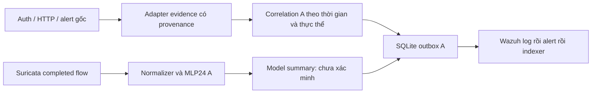

# Đối chiếu Lab A và Lab B — hướng hợp nhất

Ngày 19/10/2026. Kết luận: **giữ kiến trúc A làm nền, học cách tổ chức telemetry và đánh giá từ B; không thay MLP A bằng model B hoặc ghép hai project bằng cách chép đè.** A đã có nhiều cơ chế độ bền mà các đoạn code B được cung cấp còn thiếu.

## Cơ sở nghiên cứu và giới hạn

Đã đọc toàn bộ tài liệu `AI-Lab-A-Technical-Reference-20261019.md`, source `SOC-AI-v0.2.rar`, và 12 ZIP nằm trong `utilities.rar`. SHA256 của Live v0.4, Web, UI và Quality trùng tài liệu. Tài liệu là mô tả bàn giao; chỉ những phần đối chiếu được với source hoặc kiểm thử trong cloud mới được coi là đã xác minh ở đây.

Phần B dựa trên export ZIP trước đó, các RAR normalizer/correlation/wazuh/ubuntu đã giải nén và các kiểm tra logic đã thực hiện trong phiên nghiên cứu. Hai RAR B `ai.rar` và `data.rar` vượt giới hạn tải 32 MiB của công cụ, chưa được đọc trực tiếp. Source AI trong export ZIP và script live khác đã có không thay thế cho weights/bundle mới của B. Không có so sánh accuracy A/B trên cùng dataset và không kết luận model B tốt hơn.

Các số liệu Windows/local trong tài liệu A là kết quả được bàn giao, chưa được chạy lại trên máy bạn. Cloud hiện không có endpoint, Wazuh hay weights thật của A. Kiểm thử code không tự xác nhận trạng thái các container thực.

## Những gì A đã có và B đáng học hỏi

| Chủ đề | Lab A thực có trong source | B gợi ý gì / quyết định cho A |
|---|---|---|
| MLP | Completed network flow, 24 feature, sáu lớp; CPU inference/GPU training tách biệt. | B có hướng anomaly theo cửa sổ. Giữ hai detector thành nhánh riêng; không ghép 23 window feature vào MLP24. |
| Thu log | Collector chunk, partial line, inode/rotation/gap, checkpoint; Live có session riêng. | Học cách gom nhiều telemetry, giữ hợp đồng nguồn. Không suy ra Live đã hỗ trợ resume chỉ vì collector standalone có resume. |
| Chuẩn hóa | Adapter auth/Suricata/Apache/Wazuh, schema có version và raw hash. | B có nhiều adapter nhưng từng mất trường khi EVE nằm trong Wazuh. Thêm fallback decoded EVE và test bảo toàn IP/cổng/ID. |
| Correlation | Host + source + account + UTC, giữ evidence, nhận late input xuyên poll; login không tự thành compromise. | B từng ghép chéo host và đảo chronology. Giữ engine A; đưa các phản ví dụ này thành kiểm thử hồi quy. |
| Giao nhận Wazuh | SQLite outbox, retry, khóa publisher, event ID, lọc producer tránh feedback. | Không nhập checkpoint push B có thể tiến dù gửi lỗi. Giữ at-least-once và kiểm tra từng chặng bằng event ID. |
| Huấn luyện local | Import SSH có bằng chứng, session role; Quality bổ sung HTTP và local loss tùy chọn. | Học yêu cầu train/live parity và holdout độc lập; không dùng nhãn dự đoán làm ground truth. |
| Đóng gói | Source và Dockerfile inference; web hiện được dựng bằng installer. | B runtime khác Dockerfile. Bài học là kiểm tra fresh build; chưa gọi source hợp nhất này là full Compose portable. |

Đường xử lý nên giữ:



Prediction không tự tạo auth evidence hoặc nhãn train. Alert do chính AI sinh ra bị loại khỏi đầu vào evidence. Một request có thể có nhiều view; số alert/flow/request/case là các đơn vị khác nhau.

## Quyết định hợp nhất theo nội dung file

Source chính không còn là core v0.2 nguyên thủy: đã chứa Live v0.4, Web telemetry/SQLi, Local Data, UI và các module sửa Windows I/O. Flow Check và Local Data trong utilities giống hệt source. Trong gói Live v0.4 chỉ launcher, `lab_live.py` và config khác source chính; hai file code khác vì source đã áp UI, config đã bổ sung cấu hình hiện hành. Giữ bản source chính ở các vị trí này.

`fileio.py` trong source và Fix2 có cùng thiết kế snapshot; source còn retry `PermissionError` nói chung. Giữ source hiện hành để tránh mất sửa đổi. Retry vẫn có giới hạn; lỗi ghi checkpoint/model không bị bỏ qua như lỗi status dashboard.

Quality chưa có trong source chính. Ghép chín file chức năng/test từ gói này, gồm `train.py`, `metrics.py`, `predict.py`, `prepare_lab_mix.py` và công cụ normal HTTP. Web bổ sung bốn file chức năng/test và thư mục endpoint. Không chạy các installer patch lịch sử. Không đưa mẫu traffic `analysis-uploaded-flows.json` vào gói chia sẻ.

Không sửa architecture MLP, class order, scaler formula, tên/thứ tự feature hay feature hash:

```text
5e023c54512136448cfb711ab424a19c5ba2c9bf3240c0543c8fc4d0c1b0a065
```

Không có weights trong upload nên chưa verify bundle hiện chạy trên Windows. Doctor cung cấp lệnh để làm việc đó tại lab. Thay đổi kiểm tra ID có thể từ chối đầu vào lỗi mà code cũ từng nhận; phép tính feature của đầu vào hợp lệ giữ nguyên. Threshold dùng float64 nhất quán nên quyết định đúng tại các tie có thể đổi.

## Cải tiến đã hiện thực trong bản ứng viên

1. **Cấu hình nguồn rõ ràng:** kiểm tra object/type, container name, basename Windows, collision không phân biệt hoa thường, cùng nguồn bị khai báo hai lần và địa chỉ asset gán cho nhiều host. Replay cũng từ chối filename đi ra ngoài thư mục session. Không biến asset mapping thành whitelist attacker.
2. **EVE trong Wazuh:** ưu tiên JSON gốc trong `full_log`; khi export chỉ còn EVE trong `data`, đọc đúng các trường native. Không dùng `agent.ip` quản trị làm IP đích hay timestamp wrapper thay event time. Không gắn scan thành auth bằng group `sshd` rộng.
3. **Native ID:** giữ integer lớn dưới dạng string, từ chối float/bool hoặc ID rỗng. Cổng từ decoded EVE được kiểm tra và đổi decimal string hợp lệ sang integer; không điền IP/counters thiếu thành zero để chạy model.
4. **Provenance evidence:** `source_refs` thêm container/path từ config và byte offset từ lần đọc. Event ID không phụ thuộc reference nên cùng EVE qua Wazuh vẫn chỉ là một evidence, với hai references. Offset trỏ vào file raw trên host, không phải offset hiện thời của file trong container sau rotation. Hash tính trên nội dung dòng bỏ CR/LF.
5. **Kiểm tra chỉ đọc:** `lab_doctor.py` kiểm tra config, model/golden nếu có, từng file nguồn và process Suricata khi được yêu cầu. Bridge marker là trạng thái cài đặt; không được gọi là delivery/index success.
6. **Chạy đủ tests:** `run_checks.py` chạy cả tests ở root và `tests/`; unittest discovery mặc định trước đây chỉ chạy root vì thư mục `tests/` không phải package.

Các schema cũ giữ nguyên; source reference được bổ sung trường tùy chọn. Không thêm IF, tự chặn IP hay tự nâng `production_ready`. Không có mã nguồn B hoặc bí mật B được chép vào bản ứng viên.

## Ưu tiên tiếp theo trên lab thật

| Thứ tự | Việc làm | Bằng chứng cần có để kết luận |
|---|---|---|
| 1 | Chạy Doctor với model hiện hành, kiểm tra nguồn/interface và asset sau reboot. | Bundle verify; đúng file nguồn, Suricata process/rules/interface thật; control traffic hiện trong log. File/process tồn tại chưa đủ chứng minh capture. |
| 2 | Normal SSH/HTTP nhiều phiên độc lập; thu attack có manifest và bằng chứng riêng. | Counts, FPR và nhãn argmax tách alert decision; unknown/reject rate; local attack recall. Không chỉ nhìn metric tổng CICIDS. |
| 3 | Nếu cần, train Quality candidate mới bằng cache có sẵn; so với model cũ. | Local FPR giảm mà recall/precision tấn công còn phù hợp, holdout chưa dùng để tune; giữ model cũ. Không cần tạo lại PCAP cho việc ghép source. |
| 4 | Trace một case/event ID qua outbox, manager log, alerts.json, indexer. | Xác nhận riêng từng chặng; thử manager down rồi lên, pending còn bền. Append ACK chưa phải index success. |
| 5 | Đóng gói Compose/init/volumes và kiểm tra trên máy sạch. | Endpoint có đúng dịch vụ/rules, model mount chỉ đọc, output/outbox bền, restart còn hoạt động. Hiện còn thiếu manifest container thực của A để hoàn tất bước này. |
| 6 | Chỉ thử IF shadow hoặc process/FIM khi có telemetry và câu hỏi đánh giá rõ. | Một hàm window feature dùng chung train/replay/live, score không phụ thuộc batch, holdout theo thời gian; exec telemetry thực cho chuỗi hậu khai thác. |

Lỗi nổi bật cần giải quyết bằng đánh giá dữ liệu: model đã báo DDoS/Bot cho HTTP bình thường trong tài liệu. Một flow nhỏ không chứng minh flood; tăng threshold không sửa argmax, temperature dương cũng không đổi argmax. Thêm nhiều model hoặc nhiều epoch không thay thế được kiểm tra domain shift và normal local đại diện.

Các detector scan/SSH/web nên tiếp tục giữ đúng ngữ nghĩa: SYN-rate chưa chứng minh quét nhiều cổng; packet SSH không phải số lần sai password; HTTP SQL indicator chưa chứng minh khai thác thành công; không gắn SQLi thành lớp MLP mới chỉ bằng đổi tên output. Không nhập rules B đang có false positives URL hoặc cấu hình group rộng.
