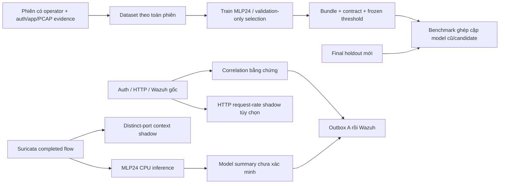

# Thiết kế nghiên cứu Lab A 0.4 — 19/10/2026

## Quyết định

Nâng cấp A thành một hệ thống kết hợp, giữ MLP24 hiện có để so sánh có kiểm soát. Một architecture mới hoặc thêm Isolation Forest chưa có bằng chứng sẽ giảm báo nhầm tại lab. Hiện vấn đề rõ nhất là domain shift, ít normal local đại diện, split chưa tách campaign và thiếu phép đo đối chiếu model cũ/candidate trên holdout thật.

Gói này là source và công cụ triển khai nghiên cứu. Nó chưa chứa model mới train trên traffic thật, chưa chứng minh FPR/recall tốt hơn A cũ và chưa được chạy trên RTX4050/Windows/Wazuh thực của người dùng.

Context không đổi nhãn MLP, không trở thành label train và không được gửi Wazuh ở release này. Không mở rộng scan/exploit ngoài tài sản lab đã xác định. Các kịch bản thật cần operator và bằng chứng độc lập; tool mặc định plan/replay, không thực thi tấn công.

## Các thay đổi phục vụ chất lượng

| Vấn đề trước | Giải pháp triển khai | Điều vẫn cần đo/giới hạn |
|---|---|---|
| Cache có hash đúng nhưng array/dtype/label/split có thể sai | Kiểm tra NPZ header/kích thước trước allocation, exact arrays, float32 Nx24, mã nhãn/split/tier/day, finite và report counts. | Hash/schema không chứng minh nhãn thật hoặc campaign độc lập. |
| Score tổng có thể che lớp attack hiếm | Quality run mới ghi supported-class/domain F1, specificity và recall lớp attack yếu nhất; selection phiên bản hóa trong checkpoint. | Chỉ áp chính sách mới cho run mới; không bảo đảm cải thiện từ công thức score. |
| Source gốc chưa có đường train mới không cần cohort cũ | Session builder + công cụ label SSH có kiểm soát; labels/raw/evidence giữ hash và whole-session role. | Chỉ học các lớp thực sự thu được. Processor tái tạo CICIDS PCAP→cohort lịch sử chưa được cung cấp. |
| Bundle có thể có số/shape sai dù file đọc được | Validate active mask/threshold/preprocessor/weights/SPEC/golden; chặn broadcasting hoặc NaN và kiểm tra CPU verify. | SHA trong metadata không phải chữ ký xác thực nhà phát hành. |
| Metric aggregate không so với model đang chạy, có thể bỏ unsupported traffic | So sánh hai bundle trên cùng input, dùng threshold đã đóng băng, per-session/scenario, unknown/coverage và effective recall. | Đầu vào mang nhãn tổng theo scenario phải được scope đồng nhất; không gắn label cho background. |
| Đổi ID có thể che dùng lại capture | Kiểm tra ID/capture/alias, logical flow identity, hash nguồn có sẵn trong provenance, chặn cùng raw EVE dùng nhiều split. | Thiếu nguồn gốc lịch sử hoặc capture khác của cùng campaign vẫn cần review. |
| Một flow nhỏ bị MLP gán DDoS | Tách kết luận từ flow score và bằng chứng nhiều request/cổng theo thời gian; không đổi tên label để che lỗi. | HTTP burst không tự chứng minh DoS, càng không chứng minh DDoS hay service outage. |
| SYN rate bị gọi là port scan | Context đếm distinct destination ports trên flow quan sát được, kiểm tra repeated-single-port negative. | Dùng completed flow, cửa sổ UTC cố định, có độ trễ và ranh giới tách; chưa là packet IDS toàn diện. |
| Lỗi parse có thể cùng tồn tại với trạng thái complete | Journal raw reference cho input context bị từ chối, hợp quality parse/pending/lateness/capacity; Live kết thúc degraded khi processing thiếu. | Outbox pending là trạng thái giao nhận riêng; append ACK chưa chứng minh alert/index. |

Feature hash vẫn là `5e023c54512136448cfb711ab424a19c5ba2c9bf3240c0543c8fc4d0c1b0a065`; không ghép auth/process/web vào vector network24, không thêm IP/ruleID/label làm feature. Lớp SQLi chưa tồn tại trong MLP; detector HTTP/Suricata/correlation giữ evidence riêng.

## Thiết kế dữ liệu và phép đo

1. Thu các **phiên** normal đa dạng: password/publickey SSH, file transfer hợp lệ, HTTP keepalive và tốc độ bình thường, DNS/TLS khi sensor có telemetry. Không xem 120 flow cùng một script như 120 thí nghiệm độc lập.
2. Thu attack có operator manifest và nguồn độc lập. Phân biệt input phục vụ MLP với evidence auth/web và context; SYN một gói có thể ngoài phạm vi MLP nhưng vẫn hữu ích cho port context.
3. Giữ toàn phiên/capture trong cùng role. Train/validation/test phát triển phục vụ iteration; final benchmark mới phải giữ riêng khỏi toàn bộ nguồn train và các split đã dùng trong quá trình phát triển.
4. Preprocessor chỉ fit train; epoch/threshold chỉ dùng validation. Test dùng đi dùng lại để chọn candidate không còn là final holdout.
5. Báo cả argmax multiclass và binary decision, per-session/scenario, total/valid/scored/unknown, scope coverage, TP/FP/TN/FN và effective recall tính cả unknown attack.
6. So model cũ và candidate trên cùng input và frozen thresholds. Gate có operating limits công khai; mức mặc định là tiêu chí nghiên cứu có thể cấu hình trước holdout, chưa phải ngưỡng tối ưu đã đo.

Wilson interval trong benchmark là xấp xỉ theo flow với giả định độc lập có giới hạn. Bootstrap theo session giúp xem biến động ghép cặp nhưng không làm các phiên trùng campaign trở nên độc lập. Với ít phiên cần báo thiếu bằng chứng; không tuyên bố accuracy cao chỉ từ vài fixture.

Chương trình train chủ động ghi `independence_verified=false`, `raw_sources_rechecked=false` cho những điều cache loader không chứng minh. Benchmark tách tiêu chí số học và evidence requirements; số đẹp không tự nâng cấp thành chất lượng được xác nhận. Không sửa cờ provenance hoặc hạ yêu cầu sau khi đã xem test chỉ để có kết quả pass.

## Vì sao chưa đưa Isolation Forest thành detector chính

Source B đã có train/live feature mismatch, batch-dependent scores và cửa sổ/entity không đồng nhất. A chưa có baseline local/window holdout đầy đủ để chứng minh lợi ích IF. Viết thêm tên model lúc này không giải quyết được các lỗi đó. Nếu làm pha tiếp theo, dùng đúng một builder train/replay/live, cùng entity/window/stride/missing-source policy, calibration cố định ngoài train, và shadow evaluation trên cùng final sessions. Score của một record không được đổi chỉ vì ghép batch khác.

Host execution/privilege escalation/exfil chưa có continuous exec telemetry được xác minh. Không gọi snapshot process theo giờ là bằng chứng thực thi đầy đủ hoặc tự gán ATT&CK stage từ một anomaly score.

## Nguồn phương pháp đã đọc

Đã tải nguồn tài liệu chính thức qua các repository của dự án; URL tài liệu render trực tiếp bị proxy chặn ở môi trường nghiên cứu. Các đường dưới trỏ đúng bản nguồn đã đọc ngày 19/10/2026; nội dung main/master có thể cập nhật sau ngày này.

- [scikit-learn — Common pitfalls](https://raw.githubusercontent.com/scikit-learn/scikit-learn/main/doc/common_pitfalls.rst): không dùng test để chọn model, preprocessing chỉ học từ train.
- [scikit-learn — Decision threshold](https://raw.githubusercontent.com/scikit-learn/scikit-learn/main/doc/modules/classification_threshold.rst): dữ liệu tune threshold phải khác dữ liệu fit classifier.
- [scikit-learn — Group/time-aware cross-validation](https://raw.githubusercontent.com/scikit-learn/scikit-learn/main/doc/modules/cross_validation.rst): phụ thuộc giữa samples cần split theo group/thời gian thích hợp.
- [scikit-learn — Calibration](https://raw.githubusercontent.com/scikit-learn/scikit-learn/main/doc/modules/calibration.rst): calibrator cần dữ liệu độc lập; softmax không tự là xác suất attack đã hiệu chuẩn.
- [PyTorch — Reproducibility](https://raw.githubusercontent.com/pytorch/pytorch/main/docs/source/notes/randomness.md): cùng seed không bảo đảm giống bit qua platform/release/CPU-GPU.
- [Suricata — EVE JSON](https://raw.githubusercontent.com/OISF/suricata/master/doc/userguide/output/eve/eve-json-format.rst): flow và HTTP transaction khác đơn vị; flow end/reason/timeout giới hạn thời điểm suy luận.

Các tham chiếu hỗ trợ thiết kế kiểm chứng; không thay thế kết quả benchmark thực của Lab A.
