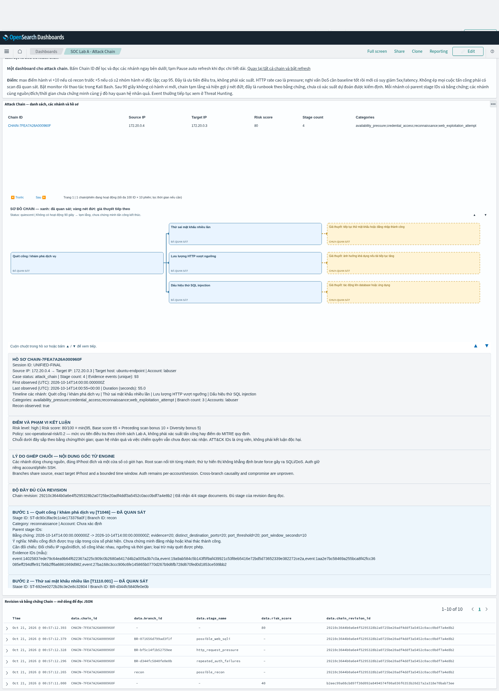

# Lab A 0.4.9 — kết quả nghiên cứu kịch bản và hướng dẫn test

**Chính sách dashboard mới:** [0.4.9.2 tự ẩn ứng viên một bước hết hạn, giữ chain từ hai bước](CHAIN-RETENTION-0492-VI.md).

**Cập nhật bộ cài:** áp dụng [bản vá 0.4.9.1](WAZUH-INSTALLER-FIX-0491-VI.md) trước khi chạy
`setup_wazuh.py` hoặc `setup_scenario_rules.py`; giữ các bước vận hành bên dưới.

Bản cập nhật tích lũy từ 0.4.6 Doctor-Fix/0.4.8, bổ sung giám sát thao tác
trực tiếp từ Kali Bash, episode isolation, lifecycle và sơ đồ chain native
trong một Wazuh dashboard. Không đổi model weights/threshold, không train lại.

Đọc theo thứ tự:

1. [Chuẩn bị, đối chiếu lỗi rule ID, cài đặt và bật monitor một lần](scenarios-049/00-PREPARE-VI.md).
2. [Nhóm 1: control, Nmap, SSH, SQLi, HTTP pressure, transfer/FIM và firewall có gate](scenarios-049/01-SINGLE-ACTIONS-VI.md).
3. [Nhóm 2: chain từng bước, sơ đồ mũi tên, khoảng tạm lắng, tách bài và các phase chưa có đủ telemetry](scenarios-049/02-ATTACK-CHAINS-VI.md).

Cách sử dụng chính: Windows mở `Start-SOC-Monitor.ps1`; đợi READY; vào Kali
Bash gõ từng lệnh trong bài. Collector tự lưu capture; attacker không nhập
SESSION hay tên bài để detector nhận diện. Host scenario runners cũ vẫn có
để tái lập bài tự động, không phải yêu cầu bắt buộc.

Dashboard giữ ID/name của **SOC Lab A - Attack Chain** và đúng 5 saved objects.
Bấm Chain ID để xem node xanh + mũi tên parent, evidence và branch. Sau khoảng
ngắt 90 giây hiện node vàng nét đứt theo từng terminal branch. Gợi ý là runbook
có điều kiện từ evidence, chưa phải mô hình next-action đã học và hiệu chỉnh
xác suất. Không tự thêm bước suy đoán vào observed count/risk hoặc gọi mọi
chuỗi là full kill chain.

Tách exact source/target IP/hostname, đợt scan mới hoặc idle gap; rebuild auth/
SQLi trong episode để tránh nhóm 600 giây cũ dán các bài vào nhau. Những hoạt
động chung IP/đích/thời gian mà không có tín hiệu phân biệt vẫn có thể chưa
xác định được ý đồ/tác nhân; được ghi như giả thuyết, không cam kết tách tuyệt đối.

Wazuh: giữ nguyên các bridge rules 119200–119214; thêm rules quan sát artifact
FIM và kernel firewall 119250–119254 trong file riêng, có collision checks,
backup và rollback. Không dùng Web Flood dựa if_matched_sid level 0 31108;
không bật Active Response/VirusTotal. Suricata giữ SID SYN observation 9900003
và SQLi 9900101/9900102; AI vẫn đếm cổng khác nhau, không đếm SYN volume là scan.

Phạm vi quan trọng: SSH mã hóa không bộc lộ command. Chuỗi shell/file 5 bước
hiện dùng telemetry probe cố định, không phải reverse shell tùy ý. FIM không
đủ để tự ghép web-shell → root → persistence. Nhóm 2.2 có các bước kiểm chứng
riêng và giữ trạng thái partial khi thiếu quyền/log, thay vì điền bước không
quan sát để làm đẹp dashboard. Slow-header DoS chưa có active-connection/
worker telemetry; bài load có giới hạn kiểm tra pressure/degradation của
request đã hoàn thành. Phần VirusTotal để sau đúng yêu cầu.

Xem [validation](scenarios-049/validation.json) để biết kiểm tra nào đã chạy
trong môi trường riêng; chưa phải kết quả E2E trên máy Windows của bạn.

Ảnh từ fixture kiểm thử native (không phải tấn công trên lab người dùng):

